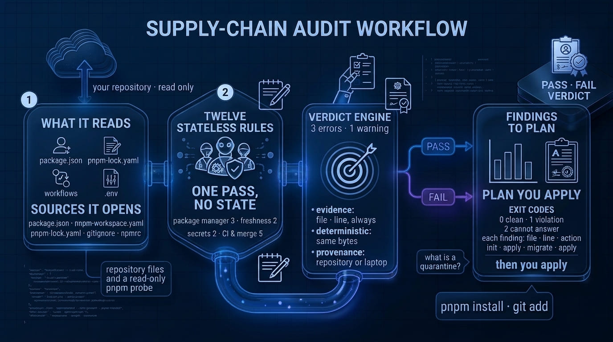

# Funky Secure 👻

[](https://github.com/MaxGB23/funky-secure/actions/workflows/ci.yml)
[](https://www.npmjs.com/package/funky-secure)
[](LICENSE)
[](https://www.npmjs.com/package/funky-secure)

`funky-secure` audits a pnpm repository and answers one question: **is this project — and the machine
that builds it — configured the way we decided?** Twelve stateless rules, the evidence each one read,
one verdict, and a write plan you read before anything is applied. For a new repository it starts
earlier: `start` prints the ordered steps that make the answer `yes`, and writes nothing itself. It
never installs, never resolves a version, never touches the network and never keeps state.

The point is a verdict you can defend: every finding names the file it read, and the line where the
rule can point at one; every action is a command or an edit; and the report says whether the policy
came from this repository or from the laptop that ran it.

```sh
npx funky-secure start                  # Node 22 or newer and nothing else: that is the whole install
pnpm dlx funky-secure@0.11.0 start      # the same command, in a repository already on pnpm
npx funky-secure scan --preset starter  # past the start: the same rules as findings, each with a → command
```



## 📦 What you get

- **A verdict with evidence.** Twelve rules over what decides what your machine installs and what your
  CI is allowed to do: the package manager pin, the lockfile, the release-age quarantine, floating
  ranges, tracked `.env` files, the CI pins, the merge path, the workflow triggers.
- **A plan instead of magic.** `init` prints every write with its absolute path and its reason, and
  `--format json` adds the digest of the exact bytes; `--apply` performs only those writes. A value
  that already exists and differs is a `conflict` you read, never an edit it makes.
- **A way out of npm.** `migrate` prints the five steps and performs only the removal of the foreign
  lockfile, and only when that cannot delete your only lockfile.
- **A contract for CI and agents.** One JSON document and four exit codes — `0` nothing to report,
  `1` a violation, `2` a question the tool could not answer, `3` a refusal, which wrote nothing — no
  prose to parse and no timestamp unless you ask for one.
- **Nothing to trust.** Zero runtime dependencies, zero development dependencies, no network, no
  cache, no daemon. Two runs over the same state produce the same bytes.

## 💡 Why this exists

The campaigns that mattered went after the credentials that live on a developer's machine — registry
tokens, cloud keys, SSH keys, OIDC tokens — and they arrive by three routes, each decided by something this tool reads: the install
path (the Shai-Hulud worm, more than 500 npm packages), the pipeline (Megalodon, more than 5,500
GitHub Actions workflows in under six hours), and a stolen maintainer credential (eighteen packages,
`chalk` and `debug` among them, published from the right account with a normal version bump).
[`docs/concept.md`](docs/concept.md#the-three-routes-in) has each case with its dates and sources.

All three end in the same place: the defenses that stop them are mostly configuration —
which manager, which lockfile, which age policy, which ignore rules, which CI pins. And a defense
nobody verifies is a defense that silently stopped working: a `pnpm-workspace.yaml` that used to carry
a release-age floor looks exactly like a hardened one. That is the gap this tool fills,
deterministically, with evidence you can review.

## 🎯 Who this is for

Both readers get the same product, and neither gets a different rule set. A beginner is pointed at the
`starter` preset, which is these twelve rules with six of them `off` by policy for day zero, and the
report says so on its own line instead of claiming coverage it does not have.

**You are starting out.** In a new project run `funky-secure start` and follow the ordered steps; in
an existing one, `funky-secure scan` and do what the `→` lines say. You do not need to know why a
72-hour quarantine matters to benefit from it, though every rule page explains the attack it prevents.
[`docs/guide.md`](docs/guide.md) has a "if you see this, do this" table for the twelve rules and
explains what each symbol and verdict means.

**You already do this for a living.** `--scope` separates repository facts from machine facts,
`--format json` and the exit codes are a stable contract for CI and agents, and
`funky-secure.config.json` moves the policy into the repository — preset, quarantine floor and per-rule
severity — instead of into whoever happened to run the command.

**You are delegating to an agent.** `funky-secure skill --install` places the instructions the binary
already prints, so an agent starts from what the tool will check: the ordered steps, the writes it may
perform only with `--apply`, and the exit code that means it refused. The skill is the same bytes the
binary answers with, so a delegation cannot drift from the binary it was given.

## 🚦 The commands

| Command | The question it answers | Writes |
|---|---|---|
| `start` | what do I run first, in which order | nothing, ever |
| `scan` | what is wrong here, with evidence | nothing, ever |
| `init` | what can be fixed, and exactly how | the printed plan, only with `--apply` |
| `migrate` | how do I leave npm or yarn | the foreign lockfile's removal, only with `--apply` |
| `pin` | how do I pin the ranges this repository already has | the specifiers it pins, with `--apply` |
| `explain` | what does one rule actually check | nothing |
| `skill` | what does an agent need to know before it acts | the skill file, only with `--install` |

## ⚡ Quick start

```sh
npx funky-secure start          # a new repository: the ordered steps, ending at --preset starter
npx funky-secure scan           # audit: read the report, follow the → lines
npx funky-secure init           # the plan, with paths; --format json adds digests; writes nothing
npx funky-secure init --apply   # perform exactly that plan
npx funky-secure skill --install   # the same rules, for an agent, before it touches the repository
```

`npx` is deliberate: the auditor needs Node and nothing else, so it runs before any package manager
decision is made — including the ones it is about to print. `pnpm dlx` is for a reader who already has
pnpm, not a reason to install it: installing a package manager is your decision rather than a side
effect of an audit. The version appears once, in the block at the top — a release edits that line and
the one in [`docs/guide.md`](docs/guide.md).

`npx` is the first-run convenience and nothing more. For anything repeatable — CI, a gate, a script —
pin it, exactly as the tool asks of the repositories it audits.

None of this changes what the audit covers. The twelve rules read the repository and its workflows —
the lockfile, the ranges, the committed ignore rules, the pinned actions, the merge path, the
permissions — so a project that already uses pnpm gets **fewer findings because there is nothing to
migrate, not a shorter check**. `start` drops only the steps that do not apply.

In a new repository, `funky-secure start` is the first command: it prints the steps that still apply,
in the order that makes them work, and writes nothing itself. Three commands write, and each only when
it is asked: `init --apply` inside the repository, `pin --apply` over the specifiers the lockfile
already resolved, and `migrate --apply` over the foreign lockfile. `start` ends by pointing the first
scan at `--preset starter`, the six rules a project needs on day zero, and states which rules that
preset leaves `off` instead of claiming a coverage it does not have.

`init` also ends with the steps it will not take for you, in order: `pnpm install` when there is no
lockfile, `funky-secure migrate --apply` when another manager's lockfile is still around, and `git add`
of what it wrote.

[`docs/guide.md`](docs/guide.md) explains how to read the report. When a command refuses, the first
line says what to do and the second says why it refused.

## 🧭 The twelve rules

| Rule | `baseline / strict` | Question |
|---|---|---|
| `package-manager-pin` | error / error | does `package.json` declare the pnpm actually answering? |
| `lockfile-committed` | error / error | is the lockfile present, tracked and not ignored? |
| `foreign-lockfile` | warn / warn alone · error / error in coexistence | does another package manager still shape this repository? |
| `quarantine` | warn / error | is the release-age quarantine a gate, or an auto-approval list? |
| `exact-versions` | warn / error | are dependency specifiers exact, and does the lockfile agree? |
| `env-not-tracked` | error / error | is any environment file committed? |
| `sensitive-ignored` | error / error | would this repository ignore the files that must never be committed? |
| `actions-pinned-sha` | error / error | can a CI workflow change under you without a commit? |
| `no-bot-auto-merge` | error / error | can a dependency update reach the default branch unread? |
| `ci-no-safety-overrides` | warn / error | does CI disable the frozen lockfile or re-enable lifecycle scripts? |
| `pull-request-target` | error / error | does a workflow combine `pull_request_target` with a checkout of the pull request head? |
| `workflow-permissions` | warn / error | does each workflow declare least-privilege `permissions:`? |

Every rule has one page under [`docs/rules/`](docs/rules/), and this table, `--help` and `explain` are
renderings of the same catalog in `src/rules/index.js`. A drift test fails when they disagree.

## 🔒 Supply chain

This tool is part of the supply chain it audits, so it carries nothing it does not need.

- **Zero dependencies**, runtime and development. No YAML parser, no CLI framework, no colour library,
  no HTTP client: `node:` built-ins plus your repository's files.
- **No network, no install, no resolution, no lifecycle script.** It runs a closed list of read-only
  probes and answers from what it read.
- **Writes only what it printed.** Every change carries its path, `--format json` adds a digest of the
  exact bytes, and `--apply` performs only those; your pnpm configuration, store and global settings
  are never written.
  One command writes outside the repository — `skill --install` places the agent skill, and only when
  asked.
- **Deterministic.** Same repository state, same bytes. `--with-timestamp` is the only exception, and
  it is opt-in.

## 🧰 Requirements

Node `>= 22`, ESM, no install step for the tool itself. pnpm is recommended and npm or yarn are
migrated, never required.

Linux and Windows are the supported platforms: the suite runs on both in CI. macOS is **not** a
supported target — it is never executed, and the owner decided it stays that way, so nothing here
claims it works there. On macOS you are on your own, and a bug report about it is read as a report
from an unsupported platform rather than as a regression.

## ✅ What is verified, and what is not

A tool that sells evidence owes its reader the same treatment, so [`docs/validation.md`](docs/validation.md)
keeps the ledger: every claim below, and every one that is missing, with what would close it.

- **The twelve rules are verified against real code** — five cloned open-source repositories, two more
  read for one rule each, and eleven real workflows — with the findings counted rather than asserted:
  53 unpinned actions in `berry`, 64 in `shadcn-ui/ui`, 32 jobs inheriting default permissions in
  `berry`, a genuine pwn request in `cloud-bulldozer`, and 206 floating ranges in `shadcn-ui/ui` with
  zero desyncs over 245 specifiers.
- **The written path was verified by strangers.** Three field rounds totalling eleven blind sessions
  were given nothing but the tool's own output, and they never read its source. Every defect they found
  was in the path — a tree left dirty, a step that named no dependency, a pin before the lockfile
  existed — and none was in a rule's decision.
- **What no test covers is the Actions runtime.** That a corrected workflow turns green on a real
  runner, and that `permissions: contents: read` really produces a `403`, is unverified: those rules
  are checked statically against the eleven real workflows recorded in
  [`docs/validation.md`](docs/validation.md). It would take a runner and a repository.
- **One hole in the rule set is known and open.** A `workflow_run` workflow that consumes an artifact
  and carries a write token can pass the CI rules today —
  [#153](https://github.com/MaxGB23/funky-secure/issues/153) — and it is a hole in what the rules
  model, not in whether they were tested.
- **macOS is a decided non-goal, not a gap.** It is never executed anywhere, and the section above
  says so instead of hedging.

## 📚 Documentation

- [Guide](docs/guide.md) — how to read the output, basic and advanced usage, and what to do per rule.
- [CLI reference](docs/cli.md) — every command, flag, exit code and JSON field.
- [Concept](docs/concept.md) — what the product is and what it refuses to be.
- [Architecture](docs/architecture.md) — the four layers and the invariants behind the guarantees.
- [Spec](docs/spec/README.md) — the normative contract: targets, rules, report, commands, exit codes.
- [Agent skill](skills/README.md) — the instructions an agent loads before touching a repository. The binary prints it, so any runtime can be given it with `pnpm dlx funky-secure skill > .agents/skills/funky-secure/SKILL.md`.
- [Documentation map](docs/README.md) — where a change belongs.
- [Decisions](docs/decisions.md) — the decision log, and the [RFC record](rfcs/README.md) it came from.

## 🛠️ Development

```sh
node --test                          # the suite: rules, commands, drift gate, goldens, self-scan
node scripts/gen-golden.js           # regenerate the golden reports after an intended change
node bin/funky-secure.js scan --scope repo --fail-on warn   # the dogfooding gate
```

The repository runs on its own standard: the suite, the drift gate and the self-scan gate every push,
and `prepublishOnly` runs them again before a release. See [`CONTRIBUTING.md`](CONTRIBUTING.md) for
the hard rules a change has to satisfy.

## 📄 License

MIT © 2026 Maximiliano González Ballesteros — see [LICENSE](LICENSE).
