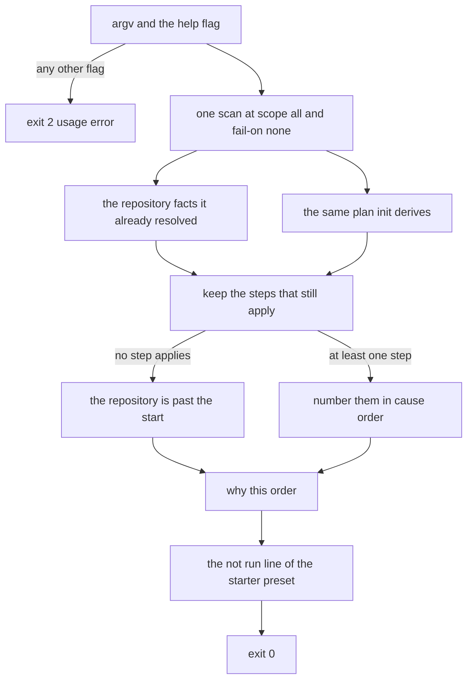
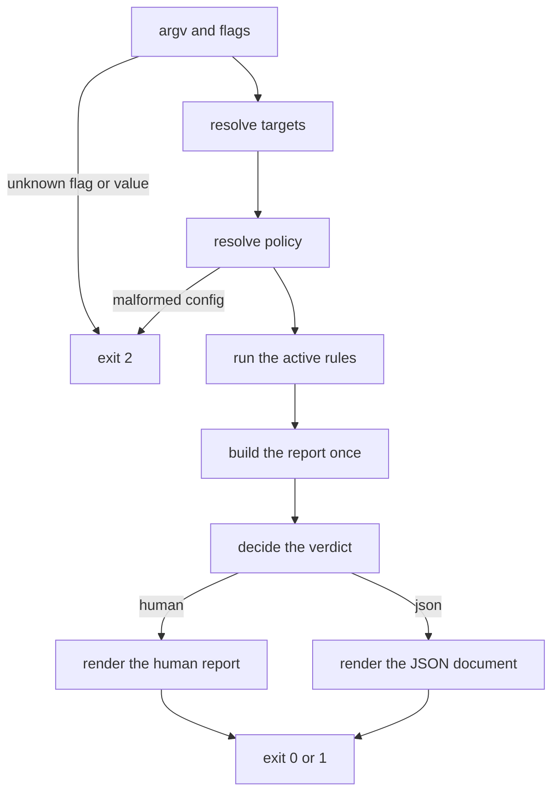
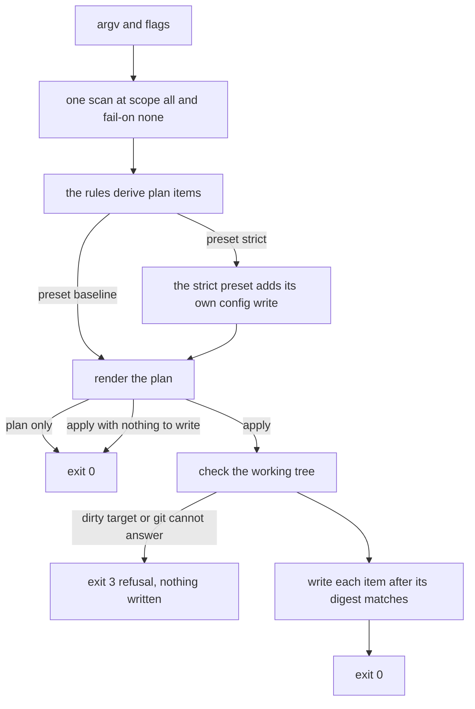
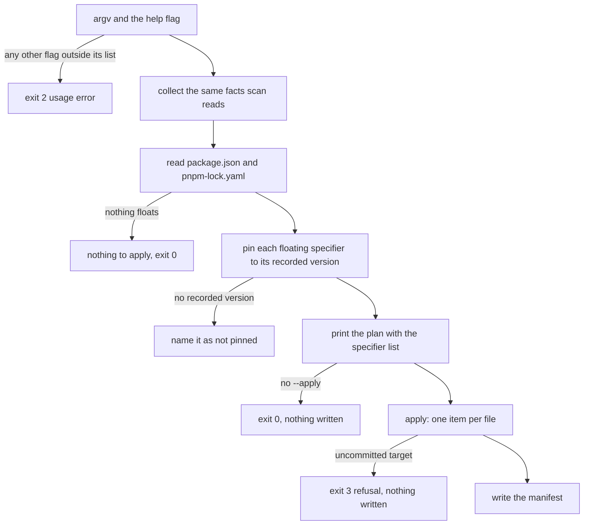
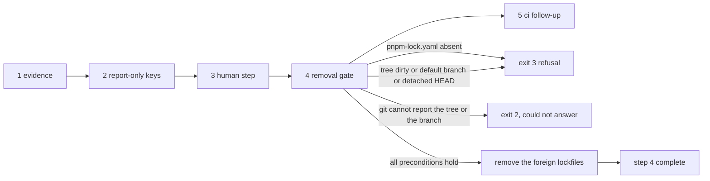
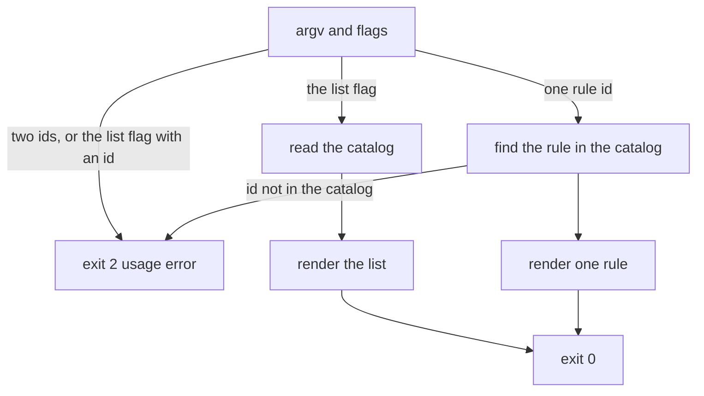
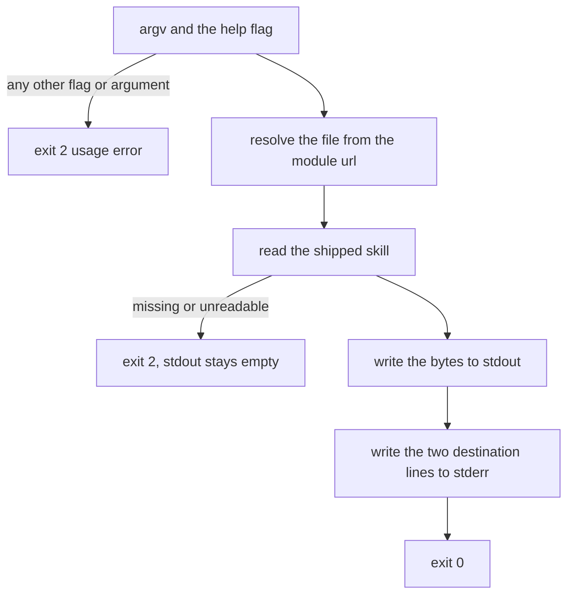
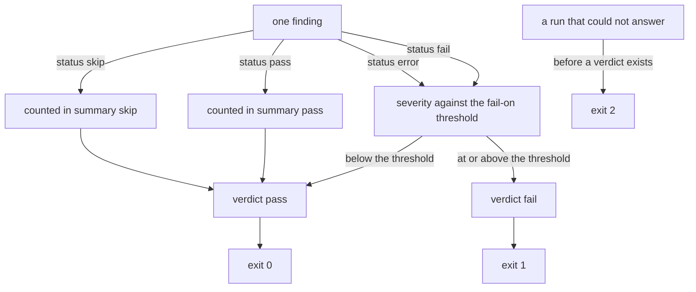

# Architecture

Four layers, one direction of data flow. The shape is the product's main defensive property: every
decision is made once, and nothing downstream can disagree with what came before it.

## The four layers

| Layer | Responsibility | Determinism |
|---|---|---|
| **Targets** | Resolve what exists: repository root, workspace importers, CI files, editor files, machine | Only I/O |
| **Collectors** | Run one declared probe per fact and cache it: `pnpm --version`, effective config, `git ls-files`, bounded file reads | Only I/O, bounded |
| **Rules** | One pure function per rule: `(ctx) → Finding[]` | Pure |
| **Report** | Aggregate, sort, decide the verdict, render human or JSON | Pure |

## Data flow

```text
                    funky-secure scan --scope repo|machine|all
                                   |
                          +--------+--------+
                          v                 v
                   Targets/Collectors   Policy (preset + overrides)
                          |                 |
                          +--------+--------+
                                   v
                          Rule engine (pure)
                                   v
                          Report (pure)
                          findings + verdict
                          /              \
                    human render      json render
                          |                 |
                    exit 0 | 1 | 2  <-------+
```

A command never talks to a rule directly. `scan` resolves targets, resolves policy, runs the engine
and renders the result. `init` runs the same collection once and derives a plan from the same
report, which is why the plan and the report cannot describe different repositories.

## Command flows

Each command is one path through the pipeline above. These diagrams are per command and stop at the
step where it can refuse; the module-level view stays in `## Data flow`.

### `start`



It reads the same collection and the same plan as `init`, so it cannot describe a repository the report
does not (11.7). It never writes: no step reaches the write path in any state.

### `scan`



Parsing the argv and resolving the policy are the only two steps that can stop it, both at exit `2`
(10.4); every later step produces a report, and the verdict it decides is the exit code (11.1).
`--verbose` and `--with-timestamp` change a rendering, never a step (10.2, 10.3).

### `init`



The decisive stop is the working-tree check immediately before the first write: a target with
uncommitted changes, or a `git status` that cannot answer, refuses with exit `3` and writes nothing
(11.2 safety rules, 11.5 point 4, 10.4). Printing a plan never reaches it.

### `pin`



One write per file, because a plan item carries the whole rewritten content: two items for one
`package.json` would leave only the last one's change. The version comes from `pnpm-lock.yaml` and from
nowhere else (4.9), so a specifier with no recorded resolution is named as not pinned instead of being
guessed. The command never installs, so it ends by naming the `pnpm install --lockfile-only` that
re-records the lockfile it just desynced by design (11.6).

### `migrate`



Outside a git worktree it refuses before printing anything, because step 4 needs a tree and a branch.
The gate is step 4 alone, and it re-checks the pnpm lockfile, the tree, the branch and `HEAD`
immediately before the first removal (11.3, 11.5 point 4). The split between the two codes is drawn per
check and not per command: a situation the tool read correctly is a refusal (`3`), and a git that
cannot answer is a question it could not answer (`2`).

### `explain`



No repository read and no probe: the only failures are argv parsing and the catalog lookup — two ids,
`--list` together with an id, or an id the catalog lacks, all exit `2` (11.4). A missing id is not a
refusal: it prints the catalog, the same bytes `--list` prints, and exits `0`. Nothing after the
lookup can fail.

### `skill`



It reads no repository fact and runs no rule: the file is resolved against the module, so the working
directory cannot move it, and the command answers the same bytes inside a repository, outside one and
in a directory that is not a repository at all (11.8). stdout is the file and stderr is the hint, which
is why the failure branch writes nothing to stdout — a redirect would save a partial file.

### The verdict



The verdict is computed once, in the report layer, from effective severities and `--fail-on` (10.5);
`--fail-on none` is a pass by construction. A `pass` and a `skip` are counted in `summary` and never
reach the comparison, so neither can fail a run (10.1, 10.4). Exit `2` is not a verdict: it is the
fail-closed code for a run that could not answer.

## Invariants

- **A rule never performs I/O.** It receives a resolved context; when a fact it needs is absent it
  returns `skip` with a reason. This is what makes the rules testable without fixtures on disk.
- **A collector is declared, not discovered.** The probe list is closed (RFC 12.1); adding one is a
  reviewed change, not an incidental import. Probes are cached per run and never retried.
- **The verdict is computed once**, in the report layer, from effective severities and `--fail-on` —
  never inside a rule, never inside a renderer.
- **Provenance is stated, never inferred.** The report says which file the preset came from and
  whether the repository itself declares the quarantine key; it never attributes an effective pnpm
  value to the project or to the machine, because the effective configuration reports no origin
  (RFC 9.4, E2). Both renderings read the one object `scan` resolved.
- **The renderers never compute evidence, and the human one may choose.** Both read the same report
  object, so they cannot disagree; a passing finding is serialized away only because the report already
  counted it. The one choice a renderer makes is which already-resolved fact to name: the `next` block
  names one rule to read next from the findings the report carries (RFC 10.3).
- **The machine is read-only, permanently.** No probe writes an environment variable, a global
  config or a store.
- **There are three write paths, and each is a plan.** `init --apply` writes only through
  `applyPlan`, `pin --apply` writes only the manifests its plan item carries, `migrate --apply` removes
  only through its step-4 function, and each writes only to the closed target catalog, after printing
  the absolute path and digest of the exact bytes, and after the same three refusals: uncommitted
  target, unreadable tree, unusable branch. The one write outside the repository is `skill --install`,
  bounded by 11.5 point 7. Nothing else in the product writes a byte.

## Module map

Every file below exists on disk; `tests/drift.test.js` fails if this page mentions a module that does
not.

| Module | Responsibility |
|---|---|
| `src/cli.js` | argv parsing, flag applicability, command dispatch, `--help`, exit-code mapping |
| `src/commands/start.js` | `start`: the ordered path of RFC 11.7, read from the same collection and plan |
| `src/commands/scan.js` | `scan`: one collection, one rendering |
| `src/commands/init.js` | `init`: same collection, derived plan, `--apply` |
| `src/commands/migrate.js` | `migrate`: the five-step RFC 11.3 plan, step-4 refusals |
| `src/commands/explain.js` | `explain`: one rule in depth, or the catalog list |
| `src/commands/skill.js` | `skill`: the shipped skill on stdout, the destinations on stderr (RFC 11.8) |
| `src/lib/config.js` | config discovery and validation (RFC 9) |
| `src/lib/engine.js` | runs the active catalog over the context and normalizes findings |
| `src/lib/errors.js` | `ConfigError` and `UsageError`, the exit-2 vocabulary |
| `src/lib/git.js` | read-only git helpers; every helper returns `null` when git cannot answer |
| `src/lib/lockfile.js` | bounded `pnpm-lock.yaml` reader for `exact-versions` (RFC 8.2 R5) |
| `src/lib/managed-block.js` | marker-based block read/replace for `init --apply` (RFC 11.2) |
| `src/lib/paths.js` | write-target validation: containment, basename, symlink escape (RFC 11.5) |
| `src/lib/plan.js` | plan items, both plan renderings, and the only write function |
| `src/lib/policy.js` | presets, overrides, precedence, quarantine floor (RFC 9) |
| `src/lib/probes.js` | the closed probe list, process spawning, the per-run collector |
| `src/lib/render-human.js` | human report rendering (RFC 10.3) |
| `src/lib/render-json.js` | deterministic JSON report rendering (RFC 10.2) |
| `src/lib/report.js` | aggregation, ordering, summary and the verdict (RFC 10) |
| `src/lib/scan.js` | the one collection: targets, policy, context, report |
| `src/lib/targets.js` | target resolution and the context a rule receives (RFC 7.1) |
| `src/lib/tool.js` | the package identity every document carries |
| `src/lib/workflows.js` | structural `jobs -> steps` workflow reader for R8 and R9 (RFC 8.2) |
| `src/lib/writers.js` | the six `init` writes: quarantine block, gitignore block, pin, strict preset (RFC 11.2) |
| `src/rules/index.js` | the catalog: catalog order is report order |
| `scripts/gen-golden.js` | regenerates `tests/golden/*.json` with a deterministic collector (RFC 15.2) |
| `scripts/check-pr-policy.js` | the issue link, single `type:*` label and branch-name gate (RFC 17 aside, `CONTRIBUTING.md`) |
| `scripts/release-guard.js` | the tag/version check and the packed-file check of RFC 17.3-17.4 |

One module per rule lives next to the catalog; a rule is pure and exports `id`, `title`, `scope`,
`targets`, `friction`, `severity`, `docs` and `detect(ctx)` — plus `plan(ctx)`, when the rule can fix
what it reported.

## Testing gates

Four gates run on every push (RFC 15, `node --test`):

- **Rule tests** — one test per rule for its question, its false-positive boundary and its `skip`
  path, against a plain context object; no test mocks `node:fs`.
- **The drift gate** (`tests/drift.test.js`, RFC 13.2) — a catalog rule without a
  `docs/rules/<id>.md` page, a page declaring an id the catalog lacks, a flag missing from `--help`
  or `docs/cli.md`, an architecture module that does not exist, a README table that disagrees with
  the catalog's severities, or a missing decision number all fail here.
- **The golden gate** (`scripts/gen-golden.js` plus the same drift file, RFC 15.2) — for each declared
  fixture repository, one committed JSON report under `tests/golden/`. The test regenerates each
  report in memory with the same deterministic collector the script uses (fixture files, `main` as the
  branch, `tracked.txt` as the index, the fixture's own `.gitignore`, no pnpm version, no clock, no
  network) and compares it byte for byte. A difference fails and says to run
  `node scripts/gen-golden.js`. Goldens are reviewed as diffs and never hand-edited.
- **The self-scan** (`tests/self.test.js`, RFC 15.4) — the real CLI over this repository with the real
  collector must exit `0` at `--fail-on warn`, print no `✖`, and its JSON report must have
  `summary.verdict === 'pass'` with every finding a `skip` that declares its reason. A rule that
  cannot pass on this repository is not releasable.

## Where a change belongs

- A new fact from the outside world → a declared probe in the collector, then a target in
  `src/lib/targets.js`. Never a `fs` call inside a rule.
- A new rule → its own module, registered in `src/rules/index.js`, with a docs page, a unit test and
  a fixture. The drift gate ties all four together.
- A new output field → `src/lib/report.js` and the two renderers, in that order.
- A new write → the plan layer and the closed target catalog. A command never writes by itself.
